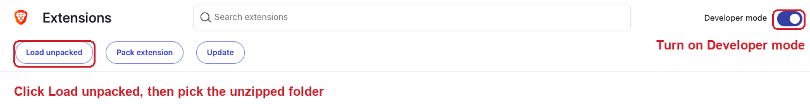

# Install DeepSeek Chat Exporter

[](https://github.com/frontmesh/DSExporter/releases/latest/download/deepseek-chat-exporter.zip)
[](README.md)

No Chrome Web Store, no account, no build step, no API key. You download a zip,
unzip it, and point your browser at the folder once. It takes about a minute.

The extension works in **Chromium-based browsers** — Chrome, Brave, Microsoft
Edge, Vivaldi, Opera, Arc, Thorium, Ungoogled Chromium, and similar — version
**116 or newer**. Firefox and Safari are not supported.

## 1. Download and unzip

**[Download deepseek-chat-exporter.zip](https://github.com/frontmesh/DSExporter/releases/latest/download/deepseek-chat-exporter.zip)**
(the latest release is also on the [releases page](https://github.com/frontmesh/DSExporter/releases/latest)).

Unzip it somewhere permanent, for example `~/Extensions/deepseek-chat-exporter`.
The folder must contain `manifest.json` directly inside it:

```text
deepseek-chat-exporter/
  manifest.json
  background.js
  content.js
  popup.html
  ...
```

Do not delete or move this folder afterwards — the browser loads the extension
from that path on every start.

## 2. Open the extensions page

Copy and paste the address for your browser:

| Browser | Extensions page |
| --- | --- |
| Chrome | `chrome://extensions` |
| Brave | `brave://extensions` |
| Microsoft Edge | `edge://extensions` |
| Vivaldi | `vivaldi://extensions` |
| Opera | `opera://extensions` |
| Arc | `arc://extensions` (or `chrome://extensions`) |
| Other Chromium browsers | `chrome://extensions` usually works; otherwise check the browser's menu |

Turn on **Developer mode** — the switch is in the top-right corner.



*Brave is shown; Chrome, Edge, Vivaldi, Opera and other Chromium browsers have the same two controls.*

## 3. Load the extension

Click **Load unpacked** and select the unzipped folder — the one containing
`manifest.json`, **not** its parent folder.

The extension appears in the list immediately; no restart is needed.

## 4. Use it

1. Open a conversation at [chat.deepseek.com](https://chat.deepseek.com/).
2. If that tab was already open before installing, **reload it once**. The
   extension needs a fresh page to attach to.
3. Pin the extension: click the puzzle-piece icon in the toolbar and pin
   **DeepSeek Chat Exporter**.
4. Click the toolbar icon, or press **Alt+Shift+D** (Windows/Linux) /
   **Option+Shift+D** (macOS).
5. Pick Brief / Standard / Detailed, click **Export summary (.md)**, and choose
   where to save in the native Save As dialog.

## Install from source (alternative)

```bash
git clone https://github.com/frontmesh/DSExporter.git
```

Then use **Load unpacked** and select the `extension/` folder inside the clone
(the one with `manifest.json`). `npm install` is only needed for development and
tests — not for running the extension.

## Updating

1. Download the new zip.
2. Unzip it **over the same folder** (replace the old files), keeping the path
   unchanged. The extension ID is derived from that path, so your style and
   toggle settings survive.
3. Click the reload icon on the extension's card on the extensions page.
4. Reload any open DeepSeek tabs.

If you load the new version from a different folder, the browser treats it as a
separate extension: your saved settings reset (only the summary style/toggles).
Remove the old copy to avoid having two.

## Uninstalling

Open the extensions page, click **Remove** on DeepSeek Chat Exporter, then delete
the folder. Nothing is left behind except the `.md` files you exported.

## Troubleshooting

| Problem | Fix |
| --- | --- |
| **Load unpacked** is missing or greyed out | Turn on **Developer mode** first. |
| “Manifest file is missing or unreadable” | You selected the parent folder. Select the folder that contains `manifest.json` itself. |
| No toolbar icon | Click the puzzle-piece icon and pin the extension. |
| Export does nothing / “Could not establish connection” | Reload the DeepSeek tab. The content script only attaches on page load, and only on `https://chat.deepseek.com/*`. |
| Popup closes while saving | Expected: the native Save As dialog is browser UI. The download continues. |
| No Save As dialog | Check the browser's download settings; the extension requests Save As explicitly, but a browser policy can override it. |
| “Disable developer mode extensions” bubble at startup | Expected for extensions installed outside the store. Dismiss it / choose to keep the extension; it is not removed unless you confirm. |
| Extension vanished after a restart | The unzipped folder was moved or deleted. Load it again from its current path. |
| Keyboard shortcut does nothing | Open `chrome://extensions/shortcuts` (or the browser's equivalent) and assign a shortcut. |
| Export fails after a DeepSeek redesign | The extension falls back to reading the page, but selectors can still break. Please open an issue with the browser version and what happened. |

## Why isn't it in the Chrome Web Store?

It does not need to be. Loading it unpacked takes a minute, avoids store review,
and the extension is fully local. The trade-offs are that it does not auto-update
and Chromium shows the usual developer-mode notice at startup. A store listing can
be added later without changing how the extension works.

## Is it safe?

- The full source is public and MIT-licensed: <https://github.com/frontmesh/DSExporter>.
- The zip contains only the extension files — no installer, no native binary, no
  remote code.
- The only network request is to `https://chat.deepseek.com/api/v0/chat/history_messages`
  on the tab's own origin, using the session you are already signed in with. If
  that fails, the page is read from the DOM.
- No analytics, no third-party servers, no account, no API key.

Optional integrity check for the downloaded zip:

```bash
shasum -a 256 ~/Downloads/deepseek-chat-exporter.zip
```

Compare the output with the SHA-256 shown in the release notes.
