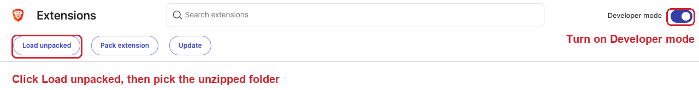

# DeepSeek Chat Exporter

**Turn a DeepSeek chat into a clean Markdown file — in one click.**

Click the toolbar button, choose how detailed you want the summary, and pick where to save it. You get a tidy `.md` file with key points, a question-by-question outline, action items, links, and an optional full transcript.

No Chrome Web Store. No account. No API key. Nothing is uploaded.

[](https://github.com/frontmesh/DSExporter/releases/latest/download/deepseek-chat-exporter.zip)
[](INSTALL.md)
[](docs/example-export.md)


Works in desktop **Chrome, Brave, Microsoft Edge, Vivaldi, Opera, Arc** and other Chromium browsers (version 116 or newer). Firefox and Safari are not supported.

## Install in 60 seconds

> **Not on the Chrome Web Store?** Right — and you don't need it. You install it straight from this page, with no store review, account, or sign-up. Chromium will show its usual "developer mode" notice at startup; that is expected.

### 1. Download and unzip

**[Download deepseek-chat-exporter.zip](https://github.com/frontmesh/DSExporter/releases/latest/download/deepseek-chat-exporter.zip)** · [all releases](https://github.com/frontmesh/DSExporter/releases)

Save it somewhere permanent — your Documents folder is fine — then unzip it:

- **macOS:** double-click the zip.
- **Windows:** right-click → **Extract All**.
- **Linux:** right-click → **Extract Here**.

You should end up with a folder that contains `manifest.json`.

### 2. Open your browser's extensions page

Copy and paste the address for your browser:

| Browser | Address |
| --- | --- |
| Chrome | `chrome://extensions` |
| Brave | `brave://extensions` |
| Microsoft Edge | `edge://extensions` |
| Vivaldi | `vivaldi://extensions` |
| Opera | `opera://extensions` |
| Arc | `arc://extensions` (or `chrome://extensions`) |
| Other Chromium browsers | `chrome://extensions` usually works |

Turn on **Developer mode** — the switch is in the top-right corner.



*Brave is shown; Chrome, Edge, Vivaldi, Opera and other Chromium browsers have the same two controls.*

### 3. Load the extension

Click **Load unpacked** and select the unzipped folder from step 1. Select the folder that contains `manifest.json`, **not** the folder above it.

The extension appears in the list. That's it — no restart needed.

### 4. Open DeepSeek and reload the tab

Go to [chat.deepseek.com](https://chat.deepseek.com/) and open the conversation you want. If that tab was already open before installing, **reload it once** so the extension can attach.

### 5. Pin it and export

Click the puzzle-piece icon in the toolbar and pin **DeepSeek Chat Exporter**. Then click its icon, or press:

- **Windows / Linux:** `Alt+Shift+D`
- **macOS:** `Option+Shift+D`

Don't move or delete the unzipped folder afterwards — the browser loads the extension from that exact path every time it starts. Detailed steps, updating, and troubleshooting live in [INSTALL.md](INSTALL.md).

## Use it

1. Open the conversation you want to save.
2. Click the extension icon.
3. Pick a summary style.
4. Optionally turn on **Include full transcript** and **Include reasoning**.
5. Click **Export summary (.md)**.
6. Choose where to save it in the native Save As dialog.

| Style | Best for | What you get |
| --- | --- | --- |
| **Brief** | A quick reminder of the conversation | Overview and a few takeaways |
| **Standard** | Everyday use | Key points plus a question-by-question outline |
| **Detailed** | Long or important chats | More key points and a longer turn-by-turn outline |

**Include full transcript** adds the complete conversation after the summary, with code blocks, links, and attachment links preserved. **Include reasoning** also keeps the model's reasoning blocks — it is off by default because that text can be sensitive.

## What the result looks like

```markdown
## At a glance

- **You asked:** My Playwright test fails intermittently in CI...
- **Bottom line:** Retries are a diagnostic tool, not a fix...
- **Topics:** test · retries · timeout · trace

## Key points

- Check the trace timeline for the first failure...
- Wait for a user-visible signal rather than an arbitrary delay...

## Action items

- [ ] Use retries temporarily with trace: 'on-first-retry'
```

[See a complete example export →](docs/example-export.md)

The file starts with a small header (title, source link, date, message count, model), so it is easy to find later in Obsidian, Notion, VS Code, or any Markdown editor.

## Is it private?

Yes — it is built to keep your chats on your machine.

- The conversation is read and summarized **in your browser**.
- Nothing is sent to the developer or any third party. There is no server, no analytics, and no telemetry.
- The only network request goes to `chat.deepseek.com`'s own API, using the session you are already signed in with — the same data the page itself loads. If that request fails, the extension reads the rendered page instead.
- Settings (style and toggles) are stored locally with `chrome.storage.local`. Chat content is never persisted by the extension.

<details>
<summary><strong>Permissions and why they are needed</strong></summary>

| Permission | Why |
| --- | --- |
| `host_permissions: https://chat.deepseek.com/*` | Read the conversation you are viewing. |
| `activeTab`, `scripting` | Connect to the current DeepSeek tab, including tabs opened before install. |
| `downloads` | Start the Markdown download with the native Save As dialog. |
| `offscreen` | Create the Blob URL for the Markdown file; MV3 service workers cannot do this themselves. |
| `storage` | Remember your summary style and toggles locally. |

The extension does not request access to any other site.
</details>

## Common questions

<details>
<summary><strong>Do I need an API key or a DeepSeek developer account?</strong></summary>

No. The extension uses the DeepSeek session already active in your browser. There is nothing to configure.
</details>

<details>
<summary><strong>Does it work on a phone or tablet?</strong></summary>

No. Chrome, Brave, Edge and other Chromium browsers on Android and iOS do not support desktop-style extensions. It is a desktop browser extension.
</details>

<details>
<summary><strong>Is it free?</strong></summary>

Yes. It is open source under the MIT license.
</details>

<details>
<summary><strong>Why does my browser warn about developer mode?</strong></summary>

Extensions installed outside the Chrome Web Store are labelled that way. It is a normal warning, not a virus warning. Dismiss the notice; the extension stays installed unless you explicitly remove it.
</details>

<details>
<summary><strong>Where is my file saved?</strong></summary>

Wherever you choose in the Save As dialog. The extension always asks; it does not silently drop files into Downloads.
</details>

<details>
<summary><strong>How do I update it?</strong></summary>

Download the latest zip, unzip it over the **same folder** (keep the path unchanged), then click the reload icon on the extension's card. Your style and toggle settings are kept. Reload any open DeepSeek tabs afterwards.
</details>

<details>
<summary><strong>How do I uninstall it?</strong></summary>

Open the extensions page, click **Remove**, then delete the folder. Exported `.md` files are untouched.
</details>

<details>
<summary><strong>Can it export all my chats at once?</strong></summary>

Not yet. It exports the conversation you currently have open, one at a time.
</details>

<details>
<summary><strong>The button does nothing / "Could not establish connection".</strong></summary>

Reload the DeepSeek tab. The content script attaches when the page loads, so a tab opened before installation needs one refresh. More fixes are in [INSTALL.md](INSTALL.md#troubleshooting).
</details>

## How it works

- **API first, page second.** It normally reads DeepSeek's own `history_messages` data; if that changes or fails, it falls back to the rendered conversation.
- **Active branch only.** If you edited a prompt or regenerated an answer, the export follows the conversation currently on screen, not discarded alternatives.
- **Local, extractive summary.** There is no LLM call. The summary engine scores sentences with TF-IDF, topic overlap, structural signals, and redundancy checks, then assembles the at-a-glance block, key points, outline, action items, code/attachment inventory, and links.
- **Honest limits.** It is not an abstractive AI rewrite, so it can miss nuance in very long chats. Use **Detailed** + transcript when you need every detail. DeepSeek redesigns can also require selector updates; the DOM fallback covers most of that.

## Troubleshooting

| Problem | Quick fix |
| --- | --- |
| **Load unpacked** is greyed out | Turn on **Developer mode**. |
| "Manifest file is missing or unreadable" | You selected the parent folder — pick the one containing `manifest.json`. |
| No toolbar icon | Click the puzzle-piece icon and pin the extension. |
| Export does nothing | Reload the DeepSeek tab; check you are on `chat.deepseek.com`. |
| No Save As dialog | Check your browser's download settings; a policy can override Save As. |
| "Disable developer mode extensions" at startup | Expected outside the store — dismiss it and keep the extension. |

More detail: [INSTALL.md → Troubleshooting](INSTALL.md#troubleshooting).

## Development

Requirements: Node.js 20+ and a Chromium browser. The integration test looks for Brave in the usual macOS/Linux/Windows locations; set `BRAVE_PATH` to override the executable path.

```bash
npm install
npm test          # unit tests
npm run test:e2e  # Brave integration test against a mocked DeepSeek page
npm run package   # builds dist/deepseek-chat-exporter-1.0.0.zip (+ stable alias)
```

The integration test covers API branch selection, Markdown summary/transcript/reasoning, the full export → offscreen Blob → `chrome.downloads` path, the DOM fallback, and the popup UI.

### Project layout

```text
extension/
  manifest.json
  background.js       service worker + download coordinator
  content.js          DeepSeek API/DOM reader and exporter
  popup.html/css/js   toolbar UI
  offscreen.html/js   Blob URL factory
  lib/shared.js       token/URL/filename helpers
  lib/markdown.js     HTML → Markdown for DOM fallback
  lib/summarize.js    local extractive summary + Markdown writer
  icons/
tests/                unit + Brave integration tests, fixtures, artifacts
docs/                 screenshots and example export
scripts/package.sh    builds the distributable zip
INSTALL.md            end-user installation and troubleshooting
```

## License

MIT
